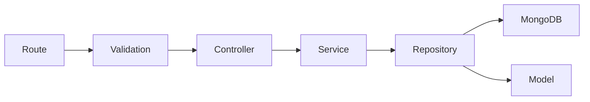

# Teacher Session Booking API

A REST API for creating users, managing teachers' available sessions, booking sessions, and viewing completed-session history.

## Project overview

The application supports the assignment workflow:

1. Create a user.
2. Create available sessions for an existing teacher.
3. Find available sessions for a UTC date.
4. Book an available session for a user.
5. Mark a booked session complete.
6. Retrieve a user's booked and completed sessions.

## Technology stack

- Node.js
- TypeScript (strict mode)
- Express.js
- MongoDB with Mongoose
- Zod request and environment validation
- Jest and Supertest integration tests
- `tsx` for development and the teacher seed script
- ESLint and Prettier

## Architecture

The application is a feature-based modular monolith. Request processing follows:



- **Routes** connect endpoint methods to validation and controllers.
- **Validation** checks request input with Zod.
- **Controllers** translate HTTP requests and responses.
- **Services** implement the business rules.
- **Repositories** perform database operations and own aggregation pipelines.
- **Models** define Mongoose schemas, defaults, validation, and indexes.

The Express app is composed in `src/app.ts`; `src/server.ts` validates configuration, connects to MongoDB, starts the listener, and handles shutdown.

## Project structure

```text
.
├── src/
│   ├── config/                 # Environment and MongoDB connection
│   ├── constants/              # Session status constants
│   ├── middlewares/            # Validation, 404, centralized errors
│   ├── modules/
│   │   ├── user/               # User model and user API layers
│   │   ├── teacher/            # Teacher model
│   │   └── session/            # Session model and session API layers
│   ├── routes/                 # Root router
│   ├── utils/                  # ApiError, ApiResponse, asyncHandler
│   ├── app.ts
│   └── server.ts
├── tests/
│   ├── helpers/
│   └── integration/
├── scripts/                    # Idempotent teacher seed script
├── docs/                       # Architecture notes
├── postman/                    # Postman collection with examples
├── .env.example
├── package.json
└── tsconfig.json
```

Feature files use the `*.routes.ts`, `*.validation.ts`, `*.controller.ts`, `*.service.ts`, `*.repository.ts`, `*.model.ts`, and `*.interface.ts` naming convention where the feature needs each layer.

## Environment configuration

Copy `.env.example` to `.env`, then set the MongoDB Atlas values:

```dotenv
NODE_ENV=development
PORT=3000
DB_USERNAME=your_mongodb_username
DB_PASSWORD=your_mongodb_password
DB_CLUSTER_URL=cluster.example.mongodb.net
DB_NAME=englishyaari
```

`DB_USERNAME`, `DB_PASSWORD`, `DB_CLUSTER_URL`, and `DB_NAME` are required. The application builds a `mongodb+srv://` URI at runtime; username, password, and database name are URL-encoded. `NODE_ENV` defaults to `development`; `PORT` defaults to `3000`. Invalid configuration stops startup and reports variable names without printing values.

The real `.env` file is ignored by Git. Keep credentials out of source control; `.env.example` contains placeholders only.

## Installation and setup

Requirements: Node.js 20 or newer, npm, and access to a MongoDB Atlas cluster matching the configured environment values.

```sh
npm install
```

After configuring `.env`, run the idempotent sample teacher seed:

```sh
npm run seed:teachers
```

Run the development server:

```sh
npm run dev
```

Build and run the compiled application:

```sh
npm run build
npm start
```

Run tests and code-quality checks:

```sh
npm test
npm run lint
npm run format:check
```

The integration suites connect to a local test MongoDB at `mongodb://127.0.0.1:27017` and drop their process-specific test databases after running. Configure a reachable local MongoDB instance for tests; the application itself constructs an Atlas SRV URI from the four variables above.

Available package scripts:

| Script                  | Purpose                                                    |
| ----------------------- | ---------------------------------------------------------- |
| `npm run dev`           | Run server using `tsx watch`                               |
| `npm run build`         | Compile TypeScript into `dist/`                            |
| `npm start`             | Run compiled server                                        |
| `npm run seed:teachers` | Insert sample teachers without duplicating matching emails |
| `npm test`              | Run Jest tests serially                                    |
| `npm run test:watch`    | Run Jest in watch mode                                     |
| `npm run lint`          | Run ESLint                                                 |
| `npm run format`        | Format project files with Prettier                         |
| `npm run format:check`  | Check Prettier formatting                                  |

## API reference

All successful responses use `{ "success": true, "message": "...", "data": ... }`. Errors use `{ "success": false, "message": "..." }`.

### 1. Create user

**`POST /users`** — Create a user. The email is trimmed and lowercased before insertion.

Request body:

```json
{
  "fullName": "Avinash Kumar",
  "email": "avinash@gmail.com",
  "phone": "9876543210"
}
```

Success (`201 Created`):

```json
{
  "success": true,
  "message": "User created successfully",
  "data": {
    "_id": "674f12345678901234567890",
    "fullName": "Avinash Kumar",
    "email": "avinash@gmail.com",
    "phone": "9876543210",
    "createdAt": "2026-11-17T12:00:00.000Z",
    "updatedAt": "2026-11-17T12:00:00.000Z",
    "__v": 0
  }
}
```

Errors: `400` invalid or missing fields; `409` duplicate email.

### 2. Create session

**`POST /sessions`** — Create an available session for an existing teacher. Intervals that overlap an existing session for the same teacher are rejected.

Request body:

```json
{
  "teacherId": "674f12345678901234567891",
  "startTime": "2026-11-20T10:00:00.000Z",
  "endTime": "2026-11-20T11:00:00.000Z"
}
```

Success (`201 Created`):

```json
{
  "success": true,
  "message": "Session created successfully",
  "data": {
    "_id": "674f12345678901234567890",
    "teacherId": "674f12345678901234567891",
    "userId": null,
    "startTime": "2026-11-20T10:00:00.000Z",
    "endTime": "2026-11-20T11:00:00.000Z",
    "status": "AVAILABLE",
    "completedAt": null,
    "createdAt": "2026-11-17T12:00:00.000Z",
    "updatedAt": "2026-11-17T12:00:00.000Z",
    "__v": 0
  }
}
```

Errors: `400` invalid ObjectId, missing fields, invalid dates, or `endTime` not later than `startTime`; `404` teacher not found; `409` overlapping session.

### 3. Get available sessions by date

**`GET /sessions/available?dateTimestamp={timestamp}`** — Return available sessions whose `startTime` falls on the supplied UTC calendar date. `dateTimestamp` is a required Unix timestamp in milliseconds. Date filtering is inclusive at UTC midnight and exclusive at the next UTC midnight. Results are sorted by start time and include selected teacher details. This endpoint uses a MongoDB aggregation pipeline.

Example: `GET /sessions/available?dateTimestamp=1795161600000`

Success (`200 OK`):

```json
{
  "success": true,
  "message": "Available sessions fetched successfully",
  "data": [
    {
      "_id": "674f12345678901234567890",
      "teacher": {
        "_id": "674f12345678901234567891",
        "fullName": "Rahul Sharma",
        "specialization": "Mathematics",
        "experience": 5
      },
      "startTime": "2026-11-20T10:00:00.000Z",
      "endTime": "2026-11-20T11:00:00.000Z",
      "status": "AVAILABLE"
    }
  ]
}
```

No matches return `200` with `"data": []`. Errors: `400` missing, malformed, or out-of-range timestamp.

### 4. Book a session

**`POST /sessions/:id/book`** — Book an available session for an existing user. Replace `:id` with the session ObjectId.

Request body:

```json
{
  "userId": "674f12345678901234567892"
}
```

Success (`200 OK`):

```json
{
  "success": true,
  "message": "Session booked successfully",
  "data": {
    "_id": "674f12345678901234567890",
    "teacherId": "674f12345678901234567891",
    "userId": "674f12345678901234567892",
    "startTime": "2026-11-20T10:00:00.000Z",
    "endTime": "2026-11-20T11:00:00.000Z",
    "status": "BOOKED",
    "completedAt": null,
    "createdAt": "2026-11-17T12:00:00.000Z",
    "updatedAt": "2026-11-17T12:00:00.000Z",
    "__v": 0
  }
}
```

Errors: `400` invalid session or user ObjectId; `404` user or session not found; `409` session is not `AVAILABLE`.

### 5. Mark session complete

**`PATCH /sessions/:id/complete`** — Mark a booked session complete. No request body is required.

Success (`200 OK`):

```json
{
  "success": true,
  "message": "Session completed successfully",
  "data": {
    "_id": "674f12345678901234567890",
    "teacherId": "674f12345678901234567891",
    "userId": "674f12345678901234567892",
    "startTime": "2026-11-20T10:00:00.000Z",
    "endTime": "2026-11-20T11:00:00.000Z",
    "status": "COMPLETED",
    "completedAt": "2026-11-20T11:00:00.000Z",
    "createdAt": "2026-11-17T12:00:00.000Z",
    "updatedAt": "2026-11-17T12:00:00.000Z",
    "__v": 0
  }
}
```

Errors: `400` invalid session ObjectId; `404` session not found; `409` session is not `BOOKED`.

### 6. Get user session history

**`GET /users/:id/sessions`** — Return the user's `BOOKED` sessions in `upcomingSessions` and `COMPLETED` sessions in `completedSessions`. `AVAILABLE` sessions are excluded. Both arrays are sorted by `startTime`. The endpoint uses a MongoDB aggregation pipeline.

Success (`200 OK`):

```json
{
  "success": true,
  "message": "User sessions fetched successfully",
  "data": {
    "upcomingSessions": [
      {
        "_id": "674f12345678901234567890",
        "teacherId": "674f12345678901234567891",
        "userId": "674f12345678901234567892",
        "startTime": "2026-11-20T10:00:00.000Z",
        "endTime": "2026-11-20T11:00:00.000Z",
        "status": "BOOKED",
        "completedAt": null,
        "createdAt": "2026-11-17T12:00:00.000Z",
        "updatedAt": "2026-11-17T12:00:00.000Z"
      }
    ],
    "completedSessions": []
  }
}
```

An existing user with no sessions gets `200` with both arrays empty. Errors: `400` invalid user ObjectId; `404` user not found.

## Database schemas

All schemas use Mongoose timestamps (`createdAt`, `updatedAt`).

| Collection | Fields                                                                                                                                                                                                                                                           | Indexes / constraints                                                                                                                      |
| ---------- | ---------------------------------------------------------------------------------------------------------------------------------------------------------------------------------------------------------------------------------------------------------------- | ------------------------------------------------------------------------------------------------------------------------------------------ |
| User       | `fullName` (required string), `email` (required string), `phone` (required string)                                                                                                                                                                               | Unique index on `email`                                                                                                                    |
| Teacher    | `fullName`, `email`, `specialization` (required strings), `experience` (required number)                                                                                                                                                                         | No unique email index                                                                                                                      |
| Session    | `teacherId` (required Teacher ObjectId ref), `userId` (nullable User ObjectId ref, default `null`), `startTime`, `endTime` (required dates), `status` (`AVAILABLE` / `BOOKED` / `COMPLETED`, default `AVAILABLE`), `completedAt` (nullable date, default `null`) | `{ status: 1, startTime: 1 }`, `{ userId: 1, status: 1, startTime: 1 }`, `{ teacherId: 1, startTime: 1 }`; validates `endTime > startTime` |

## Postman

Import `postman/collection.json` into Postman. Set the collection variables:

- `baseUrl`: API origin, default `http://localhost:3000`
- `teacherId`: existing Teacher ObjectId (sample teachers can be inserted with `npm run seed:teachers`)
- `userId`: User ObjectId
- `sessionId`: Session ObjectId
- `dateTimestamp`: Unix timestamp in milliseconds

The collection includes all six requests and representative success/error examples. Copy resource IDs from API responses or your MongoDB client into the corresponding variables.

## Known limitation

Session creation checks for an overlapping interval and then inserts. This check and insert are separate operations and are **not concurrency-safe**: concurrent overlapping create requests for the same teacher may both pass the check. Preventing that race requires an appropriate serialization strategy, such as a transaction on a MongoDB replica set; this implementation does not claim that guarantee.
